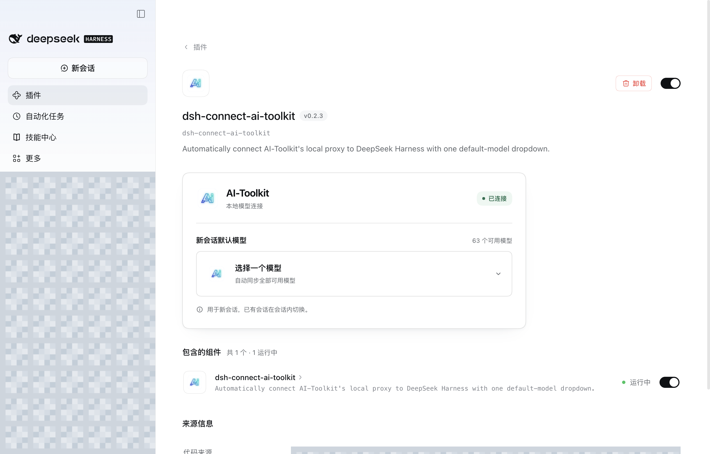
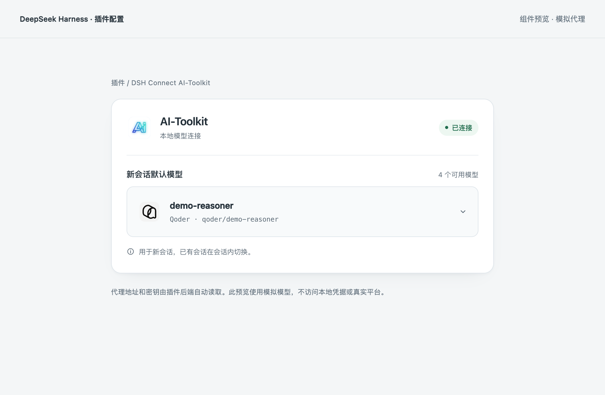

# DSH Connect AI-Toolkit

Connect **WorkBuddy, TRAE / TRAE CN, and Qoder** models to DeepSeek Harness through the local [AI-Toolkit](https://github.com/whyfail/AI-Toolkit) proxy. The plugin UI contains one **new-session default model** dropdown. The DSH host discovers the proxy URL and key; neither requires manual input.

[中文](README.md) · [Download AI-Toolkit](https://github.com/whyfail/AI-Toolkit/releases/latest) · [Reference plugin](https://github.com/dingminhua/dsh-connect-workbuddy)

## One-command installation

Supports **DSH 0.2.1-rc.3 / 0.2.1-rc.5 / 0.2.2-rc.1**. Run the desktop app at least once, then **fully quit Harness** before installing.

macOS, with the app in `/Applications`:

```sh
"/Applications/DeepSeek Harness.app/Contents/Resources/runtime/cli/bin/dsh" plugin --profile desktop add "https://github.com/whyfail/dsh-connect-ai-toolkit/releases/latest/download/dsh-connect-ai-toolkit.tgz"
```

Windows PowerShell, with the **desktop app's bundled CLI** on PATH:

```powershell
dsh.cmd plugin --profile desktop add "https://github.com/whyfail/dsh-connect-ai-toolkit/releases/latest/download/dsh-connect-ai-toolkit.tgz"
```

Reopen Harness and enable **Plugins → dsh-connect-ai-toolkit**. The standalone npm CLI cannot manage the desktop profile. DSH does not currently offer a web install protocol: the command downloads and installs the package, while activation is confirmed in the app.

Alternatively, [download the package](https://github.com/whyfail/dsh-connect-ai-toolkit/releases/latest/download/dsh-connect-ai-toolkit.tgz), enter its absolute path in **Plugins → Add plugin**, install, and enable it. [Releases](https://github.com/whyfail/dsh-connect-ai-toolkit/releases) include versioned packages and SHA-256 checksums. The package is not published to npm.

## Screenshots

Real macOS Harness UI with workspace names, conversations, account information, and local paths redacted:



Selected platform logos follow the chosen model. This Qoder example uses mock catalog data:



[Dark theme](docs/assets/settings-dark.png) · [Disconnected state](docs/assets/settings-disconnected.png) · [Narrow-screen preview](docs/assets/settings-mobile.png)

## Usage

1. Run AI-Toolkit, connect your accounts, synchronize their model catalogs, and enable its local proxy.
2. Install and enable this plugin in DSH. Open **Plugins → DSH Connect AI-Toolkit**.
3. Choose a model in **新会话默认模型**. The plugin saves the **actual DSH deployment default**, used by subsequent new sessions.

DSH and AI-Toolkit must run under the same OS account on the same machine. The proxy address is resolved by the DSH host process; access the plugin configuration page locally on that DSH host machine. The OS may request permission to read the proxy credential. Allow access and click the dropdown to retry.

The plugin uses provider ID `ai-toolkit-connect`, displayed as **AI-Toolkit（自动连接）**, so it can coexist with an existing generic `ai-toolkit` proxy profile.

Options retain exact model IDs and sources. All models remain available in DSH's conversation model picker. The plugin does not simulate selection by hiding entries or rewriting inference IDs. **Existing sessions retain their current models; switch those in the conversation itself.** This field changes DSH's new-session default, not a provider-local preference.

## Discovery and recovery

The plugin queries only proxy port settings from the current user's `~/.ai-toolkit/ai-toolkit.db` and reads the proxy key through the system credential store. Connection information stays in host memory, outside browser state, plugin configuration, and logs. Manage platform accounts, credits, and rewards in AI-Toolkit.

- When AI-Toolkit is missing or its proxy is offline, the dropdown remains keyboard-focusable and shows recovery guidance plus a download link. Click it to retry discovery.
- Denied credential authorization pauses automatic authorization retries. Allow access, then click the dropdown to retry; background checks do not repeatedly prompt.
- Installation, activation, and hot reload share one in-flight credential read across plugin instances in the same Harness host process. Successful reads and cancelled/denied outcomes survive those instance replacements. After cancellation or denial, only an explicit dropdown retry resumes the read. The proxy key stays in process memory, with no additional keychain copy, and is released when the host process exits.
- Models come from the existing `GET /v1/models` endpoint. The host synchronizes every 30 seconds while connected and checks for recovery after failures. The UI reads host state every five seconds.
- HTTP 503, timeouts, and temporary port-metadata failures retain the in-memory key. A changed port first validates the existing proxy key. Model-catalog HTTP 401 coalesces one source re-read for a rejected generation that previously authenticated; an initial key that has not yet authenticated pauses immediately without another authorization. Failed recovery stays paused until an explicit dropdown retry.
- Selection resolves the exact model using DSH's public API, saves it through the default-model service, and verifies it by reading the Host's default back. Missing host services, invalid models, and ineffective saves are reported as failures.

The plugin does not modify AI-Toolkit source, account records, or proxy configuration, and never invokes credential writes or deletion for AI-Toolkit entries. SQLite uses a read-only connection with `query_only`; WAL mode may maintain existing shared-memory indexes. Discovery stops if required WAL sidecars are missing, rather than creating or repairing them.

This prevents duplicate plugin requests, not every possible OS prompt. A real host-process restart, locked keychain, key rotation, or changed application identity may require authorization again. Legacy chunk records may also require separate item permissions.

## Installation and development

Supports **DSH 0.2.1-rc.3 / 0.2.1-rc.5 / 0.2.2-rc.1** with **Node.js 24.9 through 24.x**. Source and local npm tarball installation are provided; these instructions do not assume a published npm package.

```sh
git clone https://github.com/whyfail/dsh-connect-ai-toolkit.git
cd dsh-connect-ai-toolkit
npm ci
npm run check
npm pack
```

Enter the generated tarball's absolute path in DSH's **Plugins → Add plugin**, then install and enable it. Alternatively, use the official CLI:

```sh
dsh plugin --profile web add /absolute/path/dsh-connect-ai-toolkit-0.2.6.tgz
```

The Electron `desktop` profile is managed by the desktop application; install through its plugin UI. `npm run preview` starts an isolated component preview with mock state, without real accounts or model calls. The settings UI is Chinese-first.

## Capabilities and limits

Inference uses AI-Toolkit's OpenAI Chat Completions proxy, including streaming and DSH tool calls. AI-Toolkit owns platform account routing and actual model permissions. Catalog discovery is not proof of inference or tool compatibility.

The plugin reads `context_window` and `max_output_tokens` from the proxy catalog and passes them to Harness and the SDK. A declared 1M MiniMax Code context therefore uses 1M for client budgeting rather than a fixed 32K. Context capacity never substitutes for an unknown output limit. Missing fields independently fall back to 32,768 context tokens and 4,096 output tokens; image input remains disabled. Explicit legacy per-model budgets take precedence, while other legacy budgets serve as fallbacks. This version has no budget/capability editor and does not infer balances, prices, or other absent metadata.

Automatic discovery depends on supported AI-Toolkit data formats and OS credential backends. macOS reads the proxy entry from its shared record; Windows/Linux support its proxy record and chunk layout without enumerating platform accounts. See [validation notes](docs/VALIDATION.md) for the exact scope of real-platform testing.

MIT License. See [THIRD_PARTY_NOTICES.md](THIRD_PARTY_NOTICES.md) for references and dependencies.
