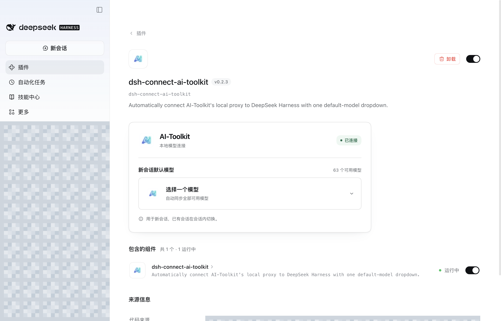
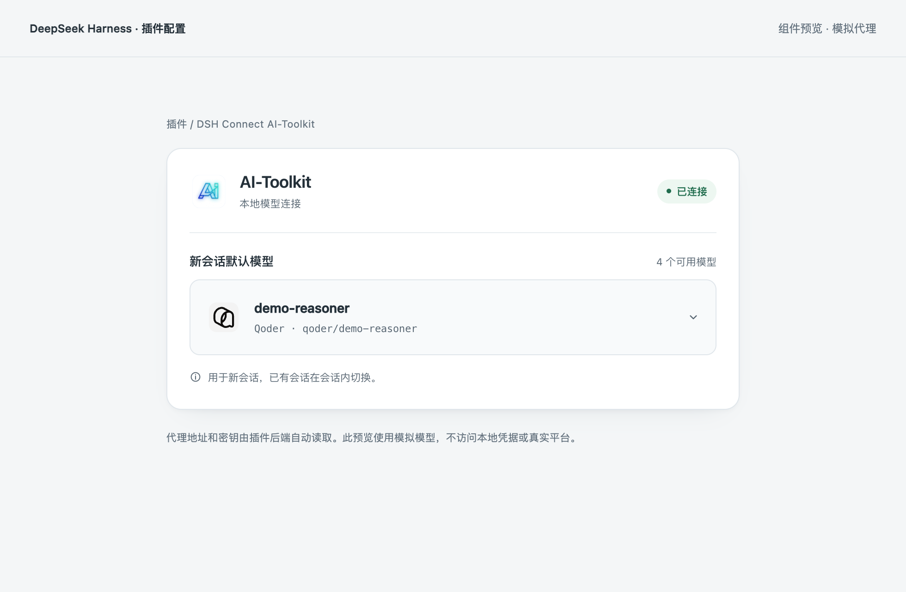

# DSH Connect AI-Toolkit

自动连接本机 [AI-Toolkit](https://github.com/whyfail/AI-Toolkit) 代理，在 DeepSeek Harness 中接入 **WorkBuddy、TRAE / TRAE CN、Qoder** 模型。插件界面只保留一个“新会话默认模型”下拉框，代理地址和 API Key 在宿主侧自动读取，无需手工填写。

[一键安装](#一键安装) · [下载安装包](https://github.com/whyfail/dsh-connect-ai-toolkit/releases/latest/download/dsh-connect-ai-toolkit.tgz) · [English](README.en.md) · [下载 AI-Toolkit](https://github.com/whyfail/AI-Toolkit/releases/latest)

## 一键安装

兼容 **DSH 0.2.1-rc.3 / 0.2.1-rc.5**。先安装桌面版 Harness 并至少打开一次，执行命令前**完全退出 Harness**。

### macOS 桌面版：复制一条命令

```sh
"/Applications/DeepSeek Harness.app/Contents/Resources/runtime/cli/bin/dsh" plugin --profile desktop add "https://github.com/whyfail/dsh-connect-ai-toolkit/releases/latest/download/dsh-connect-ai-toolkit.tgz"
```

### Windows 桌面版：复制一条命令

已将 **Harness 桌面版自带的 CLI** 加入 PATH 时，在 PowerShell 执行：

```powershell
dsh.cmd plugin --profile desktop add "https://github.com/whyfail/dsh-connect-ai-toolkit/releases/latest/download/dsh-connect-ai-toolkit.tgz"
```

命令完成后，重新打开 Harness，在 **插件 → dsh-connect-ai-toolkit** 中启用插件。安装使用桌面版自带的 CLI；单独通过 npm 安装的 DSH CLI 不能管理 `desktop` profile。DSH 当前没有网页直接安装协议，上面的“一键安装”指终端一条命令完成下载安装，启用仍由用户在应用中确认。

也可[直接下载安装包](https://github.com/whyfail/dsh-connect-ai-toolkit/releases/latest/download/dsh-connect-ai-toolkit.tgz)，在 Harness 的 **插件 → 添加插件** 中填写下载文件的绝对路径，点击安装并启用。下载受限或没有桌面 CLI 时使用此方式。版本记录及 SHA-256 校验文件见 [Releases](https://github.com/whyfail/dsh-connect-ai-toolkit/releases)。

## 界面截图

真实 macOS Harness 界面：已自动连接代理并读取模型。左侧工作区、会话、账号信息和本地路径已打码。



选择模型后显示对应平台 Logo。下图使用模拟目录展示 Qoder 的选中效果：



[深色主题](docs/assets/settings-dark.png) · [未连接状态](docs/assets/settings-disconnected.png) · [窄屏预览](docs/assets/settings-mobile.png)

## 使用

1. 打开 AI-Toolkit，在“积分与代理”中连接账号、同步模型目录并开启本地代理。
2. 在 DSH 安装并启用本插件，打开“插件 → DSH Connect AI-Toolkit”配置页。
3. 在“新会话默认模型”中选择模型，选择结果会保存到 **DSH 实际的默认模型配置**，用于之后的新会话。

DSH 和 AI-Toolkit 应使用同一个系统账号、在同一台机器运行。地址相对于 DSH 宿主进程；插件配置页面须在本机访问该 DSH 宿主。系统首次读取凭据可能要求授权，允许后点击下拉框重试。

插件供应商标识为 `ai-toolkit-connect`，在 DSH 中显示为 **AI-Toolkit（自动连接）**，可与已有的 `ai-toolkit` 通用代理配置共存。

模型选项保留完整 ID 和来源，全部模型仍出现在 DSH 会话自身的模型选择器中。插件不会过滤模型目录来假装切换，也不会改写模型调用 ID。**已有会话继续使用其原模型，请在该会话内切换**；本插件的字段修改的是 DSH 的新会话默认值，而不是独立的提供商偏好。

## 自动连接与恢复

插件只读查询当前用户 `~/.ai-toolkit/ai-toolkit.db` 中的本地代理端口设置，并通过操作系统凭据库读取代理 API Key；连接信息只保存在宿主内存中，不返回浏览器、不写入插件配置或日志。账号登录、余额和积分领取继续在 AI-Toolkit 中管理。

- 未安装、应用未打开或代理未开启时，下拉框保留键盘焦点，说明如何恢复并提供下载链接。点击下拉框可重新检测。
- 系统凭据访问被拒绝后暂停自动授权重试；允许访问后，点击下拉框再试，避免后台反复弹窗。
- 首次安装、启用和热重载产生的多个插件实例，共用当前 Harness 宿主进程中的同一笔凭据读取；授权弹窗等待期间不再排队发起重复请求。成功结果及取消／拒绝状态均跨实例保留；取消／拒绝后，只有明确点击下拉框重试才重新授权。密钥只保留在宿主内存，退出进程后释放，不新增钥匙串副本。
- 模型目录来自现有 `GET /v1/models`。连接正常时每 30 秒同步，断线时检查恢复；界面每 5 秒读取宿主状态。
- 已有连接遇到 HTTP 503、超时或临时端口元数据错误时保留内存密钥，不反复访问凭据库。端口改变时先验证已有代理密钥。模型目录 HTTP 401 对同一代已通过鉴权的缓存只合并一次来源重读；首次尚未通过鉴权的密钥若被拒绝，则直接暂停，不紧接着再次授权。重读或认证仍失败后，需点击下拉框人工重试。
- 下拉框提交后，通过 DSH 公开的模型解析和默认模型服务保存，再读回确认。宿主缺少配置编辑服务、模型失效或保存不成功时，会明确报错，不将未生效的本地偏好显示为成功。

插件不修改 AI-Toolkit 源码、账号记录或代理配置，不调用其凭据写入和删除操作。SQLite 使用只读连接和 `query_only`；WAL 模式下 SQLite 可能维护已有的共享内存索引。缺少必要 WAL 辅助文件时停止读取，不补建或修复文件。

此优化针对插件重复发起的授权请求，不保证操作系统永远只显示一次提示。真正重启宿主进程、钥匙串锁定、密钥轮换或应用身份变化时，系统仍可能重新询问；旧版分块凭据也可能按不同条目分别授权。

## 安装与开发

开发要求 **Node.js 24.9 至 24.x**。公开安装包通过 GitHub Releases 提供；尚未发布到 npm。

```sh
git clone https://github.com/whyfail/dsh-connect-ai-toolkit.git
cd dsh-connect-ai-toolkit
npm ci
npm run check
npm pack
```

在 DSH“插件 → 添加插件”中填写生成压缩包的绝对路径，安装并启用；或使用官方 CLI：

```sh
dsh plugin --profile web add /absolute/path/dsh-connect-ai-toolkit-0.2.4.tgz
```

Electron 桌面的 `desktop` profile 由桌面应用管理，请通过桌面插件界面安装。`npm run preview` 是使用模拟数据的独立组件预览，不读取真实账号或产生模型调用。

## 模型能力与范围

模型调用使用 AI-Toolkit 的 OpenAI Chat Completions 代理，保留流式响应与 DSH 工具调用。平台账号调度和实际权限由 AI-Toolkit 负责，模型目录发现不等于推理或工具能力已实测。

现有目录接口不包含积分余额、价格倍率或完整能力参数，因此不展示或推断这些数据。无元数据时使用明确的客户端预算默认值：上下文 32,768 Token、最大输出 4,096 Token，图片输入默认关闭。本版不提供预算或能力编辑控件；旧版预算保留由内部兼容逻辑处理。

自动发现需要对应版本的 AI-Toolkit 数据格式与系统凭据后端。macOS 使用其共享凭据中的代理条目，Windows/Linux 兼容其代理条目与分块布局；不枚举平台账号。跨平台真实运行的验收范围见 [验证记录](docs/VALIDATION.md)。

MIT License。设计参考与依赖说明见 [THIRD_PARTY_NOTICES.md](THIRD_PARTY_NOTICES.md)。

设计参考：[dsh-connect-workbuddy](https://github.com/dingminhua/dsh-connect-workbuddy)。
