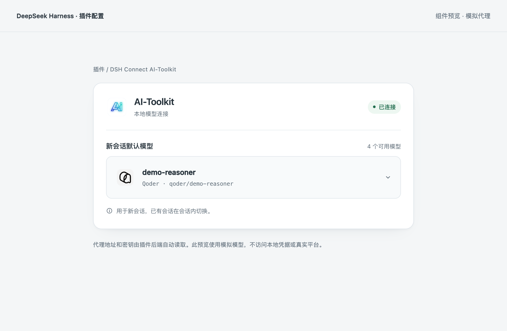

# 验证记录

## v0.2.6：DSH 0.2.2-rc.1 兼容升级（2026-11-06）

本机桌面运行时为 DSH 0.2.2-rc.1、Cordis 4.1.0、Schemastery 3.19.0、pi-ai 1.3.0。旧版插件的 DSH peers 仅接受 0.2.1-rc.3 / rc.5，新版宿主会将其标记为不兼容。v0.2.6 明确加入当前 DSH 与配套库的版本范围，开发依赖固定到本机运行时版本；不使用兼容性豁免，也不放开未经验证的 DSH 版本。

新版 `ResolvedPiAiProviderProfile` 新增 `maxRequestImages` 与 `imageOffloadCountQuantum` 必填项，插件按 SDK 默认值补充 50 / 10。模型注册、流式响应、工具调用、图片、Token 预算、默认模型保存桥及 HTTP 权限的现有回归均通过。

- `npm run check`：类型检查、**111 项测试**与宿主／浏览器构建通过，基于 nvmd Node.js 24.21.0。
- 新增 6 项真实 `evaluatePluginCompatibility` 检查：接受三个声明支持的版本，拒绝未验证的 0.2.1-rc.4、0.2.2-rc.2 与 0.3.0。
- 安装包分别在独立临时目录安装 DSH 0.2.1-rc.3、0.2.1-rc.5 与 0.2.2-rc.1；宿主入口导入、浏览器模块包装、图标及真实兼容性判定通过。

安装包检查默认使用当前版本；旧版可执行 `DSH_TEST_VERSION=0.2.1-rc.3 npm run test:package` 或 `DSH_TEST_VERSION=0.2.1-rc.5 npm run test:package`。这些检查不代表三平台账号的真实推理验收。

## v0.2.4 验证基线

验证日期：2026-11-03。开发环境：macOS Apple Silicon、nvmd Node.js 24.21.0；自动化基线 DSH 0.2.1-rc.5，本机桌面应用 DSH 0.2.1-rc.3。

## 已完成的自动化检查

`npm run check`：类型检查、**101 项测试**及宿主／浏览器构建通过。

`npm run test:package`：v0.2.4 tarball 的独立安装、宿主入口导入及浏览器模块包装检查通过。

- 增加真实 LLM 服务下与已有 `ai-toolkit` 通用供应商共存的回归测试。插件使用独立的 `ai-toolkit-connect` 标识，卸载注册后已有供应商保持可用。

- 界面与默认模型选择桥共 **17 项**：唯一字段、完整模型 ID/来源、选择提交至默认模型接口、失败仍可聚焦、指针与焦点重试去重、凭据授权提示、每 5 秒同步状态、失败恢复已确认选择、下架默认模型保留并标记不可用、特殊原型名称作为普通字符串、缺少服务时禁止选择、CSRF 请求头。
- 选择桥验证先解析模型、调用 DSH 公开默认模型服务、保存后读回；缺少配置编辑服务、静默未生效保存、解析失败或身份不一致时拒绝。
- 自动发现使用隔离数据库、模拟凭据读取和本地测试服务验证连接元数据与凭据布局契约，不等同于真实系统凭据授权测试。
- 其余测试覆盖代理转发、流式响应、工具调用、取消、错误处理、密钥重读控制、公开状态脱敏及宿主 HTTP 接口权限。

本轮界面只有“新会话默认模型”下拉框，不含地址、密钥、预算输入或操作按钮。选择的是 **DSH 新会话默认模型**，已有会话继续使用各自的模型。测试不把插件内偏好保存或列表过滤当作切换成功。

连接建立后的 HTTP 503、超时或临时连接元数据错误不应重复访问系统凭据库。目录接口 HTTP 401 对同一代已通过鉴权的缓存只合并一次来源重读；首次尚未通过鉴权的来源密钥被拒绝则直接暂停。重读或认证仍失败后，需点击下拉框人工重试。

## 界面检查与截图

浅色已连接、深色已连接、未连接及窄屏长模型名组件预览的 WCAG 2 A/AA 自动检查均为 **0 违规项**。这仅覆盖相应组件状态，不能替代人工无障碍验收或真实 DSH 宿主检查。

390px 窄屏长模型名检查确认横向滚动宽度为 390px，长名称与 ID 省略显示；原生菜单选项仍保留完整文本。页面有且仅有一个 select，没有 input 或 button。浏览器确认 Tab 可聚焦选择器并显示焦点环，离线态聚焦可重新检测，下载链接未被选择器覆盖；原生 select 自动化选择后，展示值与保存结果同步。无头浏览器的方向键菜单选择未完成实证，仍需真实桌面人工检查。

本轮样式增加品牌区、连接状态、来源标识、模型名与 ID 双行展示、浅深主题和减少动态效果适配。选择逻辑及后端连接实现未修改。

以下为独立组件预览，模型为模拟数据，不代表真实平台模型权限、真实系统密钥授权或宿主端到端验收。



[深色主题](assets/settings-dark.png) · [未连接状态](assets/settings-disconnected.png) · [窄屏预览](assets/settings-mobile.png)

## 本机桌面安装

通过 `/Applications/DeepSeek Harness.app` 的真实插件页面，将本地 v0.2.2 压缩包安装到现有 `desktop` profile 并启用。重启桌面应用后，插件组件显示“运行中”，设置卡片正常渲染，启动注入的 CSRF 标记存在，状态接口可用；本机代理 `/health` 响应正常。

安装时核对了 rc.3 与 rc.5 的相关公开接口。修正了与已有 `ai-toolkit` 供应商的名称冲突、宿主 `data-ds-dark-theme` 标识适配，以及宿主状态色作为小号文字时对比度不足的问题。

用户在 macOS 系统安全弹窗中完成授权后，真实桌面配置页显示“已连接”和 **63 个可用模型**，确认本机代理地址、代理密钥自动读取和鉴权目录同步成功。插件字段仍为未选择状态；未操作实际默认模型保存或真实推理，不能将目录同步成功记作这些场景通过。

原始本机截图保存于项目的 `artifacts/` 目录，不进入仓库或分发包。README 使用重新采集并已遮挡工作区、会话、账号信息和本地路径的公开副本。

## 复现

```sh
npm ci
npm run check
npm pack
npm run test:package
```

`npm run preview` 使用模拟状态展示当前组件，可使用 `?selected`、`?offline`、`?denied`、`?detecting`、`?long` 及 `?selected&theme=dark` 检查不同状态。进行真实 DSH Web 验证时，应使用隔离的 `DSH_HOME`，再通过官方 CLI 安装压缩包；Electron 的 `desktop` profile 由桌面应用管理，应通过其插件页面安装。插件配置页面仅允许在本机访问该 DSH 宿主。

## 尚未完成的真实环境验收

- 在真实 DSH 宿主中的新会话默认模型保存与生效流程。
- Windows、Linux 实机上的首次授权与自动发现。
- 三平台真实账号推理、图片理解和积分扣减。
- 其他 DSH 或 AI-Toolkit 版本的数据格式兼容性。

离线测试、模拟代理回复、组件预览和开源发布不能证明上述场景已通过。安装包通过 GitHub Releases 提供，尚未发布到 npm。

## v0.2.3 Logo 更新

通过实际桌面插件页升级并启用 v0.2.3，重新打开后确认连接正常，仍显示 63 个可用模型。宿主顶部与卡片标题使用正式 AI-Toolkit Logo；选择模型的展示区按来源切换 WorkBuddy、Qoder 或 TRAE Logo，自动路由使用 AI-Toolkit Logo，未知来源保留通用图标。新增切换与失败回退检查；三平台与深色、窄屏预览的图像均可加载。

安装包检查确认 manifest.icon 指向已打包的合法 PNG，浏览器图片以 data URL 内嵌，无需远程图标请求。原始截图仅保存在 artifacts；公开的真实截图已经完成隐私遮挡检查。

## v0.2.4 首次安装重复授权修复

新增 21 项回归检查，覆盖同一进程内并发实例及模块热重载共享读取、成功缓存、取消／拒绝跨实例暂停、人工重试去重、来源隔离、同代 401 恢复合并、过时代次不能清除新密钥、原生异常脱敏、端口变化不重复读取，以及首次来源密钥被拒绝后不再次授权。定序测试还覆盖来源读取结束、首个目录鉴权尚未返回时，新实例启动不能触发第二次来源读取。

macOS 原生授权不再设置合成超时，而是等待系统返回确认或取消结果。实例销毁不清除全进程正在等待的原生读取；密钥仅在宿主进程内共享，不写配置、不新增系统凭据副本。

本机已通过桌面应用自带 CLI 将最终 v0.2.4 安装至现有 desktop profile，核对安装后的宿主入口与最终构建 SHA-256 一致。重新打开 Harness 后，插件显示“运行中”“已连接”和 63 个可用模型，已有默认模型保持不变。未重置钥匙串权限，也未发起真实模型推理。

这些自动化测试使用替身凭据，不修改真实钥匙串权限，不能证明某台机器首次安装时系统弹窗的准确次数。真实宿主进程重启、钥匙串锁定、密钥轮换、应用身份变化及旧版多条目凭据仍受系统授权规则约束。

## v0.2.5：目录容量与 1 Token 截断修复（2026-11-05）

本机 MiniMax-M3.1-Flash 长会话记录显示：旧插件声明 32,768 上下文，SDK 根据上一条回复用量与后续输入，再预留 4,096 Token，将输出预算压至 1；上游真实返回 1 个输出 Token 和 `length`，界面正确显示截断。问题来自客户端容量缺失，结束状态转换无需修改。

AI-Toolkit 模型目录增加 `context_window`／`max_output_tokens`，插件读取相应容量；缺失字段仍独立回退，显式单模型预算继续优先。长输入回归先复现旧配置发送 `max_tokens=1`，再验证目录声明 1M 后发送 4,096，且调用方显式指定 1 Token 时仍保留真实截断。未知输出上限、非法容量、缓存往返与多账号路由的共同容量经过回归。`npm run check` 的类型检查、105 项测试和构建通过；AI-Toolkit 积分代理模块 233 项测试通过。

当前安装版尚无容量扩展时，在本机插件私有配置中仅为两个 MiniMax Code 路由补充已由账号目录确认的 1M 上下文，通过真实插件管理页停用再启用使其生效。原问题会话中再次发送简短问答后，上下文占用从 88% 降为 3%；真实代理记录为 28,838 输入 Token、1,270 输出 Token，Harness 以 `completed` 正常结束，并在界面完整显示五点回复。未改写已有会话事件、停止状态、凭据或代理账号配置。本次没有发布安装包或更新已安装应用二进制；跨平台实机与新的目录扩展在发布版中的验收仍待完成。
